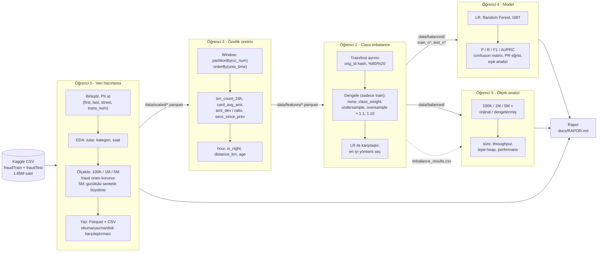

# Mimari

Tüm işlem tek makinede **PySpark (local[*])** ile yapılır; driver ve executor aynı JVM'dedir.
Her adım bir sonrakine diskteki Parquet dosyalarıyla veri aktarır. Böylece adımlar birbirinden
bağımsız çalıştırılabilir ve kesintiden sonra kaldığı yerden devam edilebilir.

## Tasarım kararları

| Karar | Neden |
|---|---|
| Ara veriler Parquet | Sütun bazlı okuma, sıkıştırma ve şema korunur; CSV'ye göre hem daha küçük hem daha hızlı (Öğrenci 1 ölçümleri). |
| Train/test ayrımı `orig_id` hash'i ile | 5M'deki sentetik kopyalar orijinal satırla aynı tarafa düşer: test setine "train'deki satırın gürültülü kopyası" sızmaz. Hash etiketten bağımsız olduğu için sınıf oranı korunur. |
| Window özellikleri dengelemeden önce | Oversample ile çoğaltılan satırlar aynı kartın 24 saatlik işlem sayısını şişirir, undersample gerçek geçmişi siler. |
| Window'lar sadece geçmişe bakar | `rowsBetween(unboundedPreceding, -1)`, `rangeBetween(-86400, 0)`, `lag`: bir işlemin özelliği gelecekteki işlemleri görmez. Bu, gerçek zamanlı skorlamada da hesaplanabilir. |
| Özellik pipeline'ı (StringIndexer, OneHot, StandardScaler) sadece train'e fit | Test istatistikleri modele sızmaz. |
| Dengeleme sadece train'e | Test gerçek dağılımda kalır; metrikler sahadaki performansı yansıtır. |
| Sonuçlar satır satır CSV'ye, çıktılar `_SUCCESS` kontrolü ile | Uzun 5M çalıştırmaları kesilirse sadece o anki deney kaybolur; tekrar çalıştırınca eksikler tamamlanır. |
